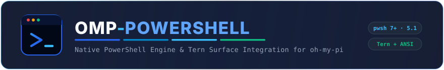

<p align="center">
  <picture>
    <source media="(prefers-color-scheme: dark)" srcset="assets/header-dark.svg">
    <source media="(prefers-color-scheme: light)" srcset="assets/header-light.svg">
    
  </picture>
</p>

<p align="center">
  <a href="#highlights">Highlights</a> ·
  <a href="#install">Install</a> ·
  <a href="#use">Use</a> ·
  <a href="#architecture">Architecture</a> ·
  <a href="#configuration">Configuration</a> ·
  <a href="#documentation">Documentation</a>
</p>

<br>

**omp-powershell** brings first-class, native PowerShell execution to [oh-my-pi](https://omp.sh). It eliminates fragile shell-within-shell wrappers (`powershell.exe -NoProfile -Command "..."`), bypasses command-line escaping collisions and argument length limits through direct piped-stdin execution, auto-detects both modern PowerShell 7+ (`pwsh`) and Windows PowerShell 5.1, guarantees UTF-8 console encoding, and renders real-time execution cards across both Tern Surface Protocol (TSP) and ANSI terminal interfaces.

## Highlights

- **Direct Piped Execution**: Scripts stream via standard input (`-Command -`), completely bypassing Windows command-line character limits and nested quote escaping.
- **Dual-Engine Auto-Discovery**: Automatically discovers, probes, and caches modern **PowerShell Core (`pwsh.exe` 7+)** and **Windows PowerShell (`powershell.exe` 5.1)** with intelligent fallback.
- **Tern Surface Protocol (TSP) Native Cards**: Implements `describeCall` and `describeResult` with syntax-highlighted code blocks, follow-scrolled terminal output, execution timers, status badges (`[pwsh 7.6.9]` / `[PS 5.1]`), and `mergeCallAndResult: true`.
- **ANSI Terminal Fallback**: Beautiful CLI fallback rendering with `PS>` prompt styling, elapsed durations, exit code indicators, and tail-clipped scrolling previews.
- **Automatic Bash Interception**: Intelligent `tool_call` hooks detect when LLMs attempt to run PowerShell inside `bash` commands, advising them to use native `powershell` execution instead.
- **Guaranteed UTF-8 Console Encoding**: Injects console preambles to ensure object tables, Unicode glyphs, and non-ASCII character streams decode accurately without mojibake.
- **Live Output Streaming**: Streams incremental stdout and stderr chunks directly to the UI as processes execute.
- **Interactive Slash Commands**: Run `/powershell` or `/ps` to inspect installed engines, probe paths, and execute commands interactively.

## Install

Requires [`oh-my-pi`](https://omp.sh).

```bash
omp plugin install github:oopsmishap/omp-powershell
```

Update or remove it using standard plugin commands:

```bash
omp plugin upgrade omp-powershell
omp plugin disable omp-powershell
omp plugin enable omp-powershell
omp plugin uninstall omp-powershell
```

For development:

```bash
git clone https://github.com/oopsmishap/omp-powershell.git
cd omp-powershell
bun install
omp plugin link .
```

## Use

### Agent Tools

The plugin registers two native tools for coding agents:

- **`powershell`**: Primary tool for executing arbitrary PowerShell scripts, pipelines, and cmdlets.
- **`pwsh`**: Pinned alias for modern PowerShell Core (PowerShell 7+).

#### Example Tool Call

```json
{
  "command": "Get-Process | Sort-Object CPU -Descending | Select-Object -First 5 -Property Id, ProcessName, CPU, WorkingSet64",
  "cwd": "C:\\Users\\mishap\\projects",
  "i": "Inspecting top CPU consuming processes"
}
```

#### Parameters

| Parameter | Type | Required | Default | Description |
|---|---|---|---|---|
| `command` | `string` | **Yes** | — | PowerShell script block, pipeline, or cmdlet command. |
| `cwd` | `string` | No | Working directory | Target execution directory (handled via `-LiteralPath`). |
| `edition` | `string` | No | `"auto"` | Engine selection: `"auto"`, `"core"` (pwsh 7+), or `"desktop"` (Windows PowerShell 5.1). |
| `env` | `object` | No | `{}` | Key-value pairs injected as process environment variables (`$env:KEY`). |
| `timeout` | `number` | No | `300` | Execution timeout deadline in seconds (0 disables). |
| `i` | `string` | No | — | 2–6 word present-participle intent summary for card headers. |

### Slash Command

Run `/powershell` or `/ps` directly in chat:

```text
/ps
```

Shows active and detected PowerShell engines:
```text
PowerShell Engine Status:
• Core (pwsh.exe): v7.6.9 at C:\Program Files\PowerShell\7\pwsh.exe
• Desktop (powershell.exe): v5.1.26100.2161 at C:\Windows\System32\WindowsPowerShell\v1.0\powershell.exe
Active Default: Core (v7.6.9)
```

You can also execute one-off commands interactively:

```text
/ps Get-ChildItem -Path Env: | Select-Object -First 3
```

### Bash Interception & Auto-Guidance

When an agent attempts to wrap PowerShell commands inside `bash` (e.g. `bash({ command: 'powershell.exe -NoProfile -Command "..."' })`), omp-powershell intercepts the call, extracts the inner script, and injects actionable guidance:

```text
Notice: The native 'powershell' and 'pwsh' tools are available in this session. Instead of wrapping PowerShell commands inside bash (e.g. powershell.exe -Command "..."), call the 'powershell' tool directly with your script in the 'command' argument to avoid quoting issues, preserve exit codes, and enable native streaming.
```

## Architecture

```
┌────────────────────────────────────────────────────────────────────────┐
│                        oh-my-pi Runtime Agent                          │
└──────────────┬──────────────────────────────────────────┬──────────────┘
               │                                          │
       [powershell Tool]                          [bash Interception]
               │                                          │
               ▼                                          ▼
   ┌──────────────────────┐                     ┌────────────────────┐
   │ Piped Stdin Pipeline │                     │ Hook Guidance      │
   │ -NoProfile           │                     │ Re-routes to       │
   │ -NonInteractive      │                     │ Native PowerShell  │
   │ -ExecutionPolicy     │                     └────────────────────┘
   │ -Command -           │
   └───────────┬──────────┘
               │
   ┌───────────▼─────────────────────────────────────────────────────────┐
   │ UTF-8 Console Preamble Injection                                    │
   │ [Console]::OutputEncoding = $OutputEncoding = UTF8                  │
   └───────────┬─────────────────────────────────────────────────────────┘
               │
       ┌───────┴───────────────────────┐
       ▼                               ▼
┌──────────────┐               ┌──────────────┐
│  pwsh (7+)   │               │ powershell   │
│ PowerShell   │               │ Windows PS   │
│ Core Engine  │               │ Desktop 5.1  │
└──────┬───────┘               └──────┬───────┘
       │                              │
       └──────────────┬───────────────┘
                      │ Live Output Streaming
                      ▼
   ┌─────────────────────────────────────────────────────────────────────┐
   │ UI Render Layer                                                     │
   │ • Tern Surface Protocol (TSP) Native Cards                          │
   │   (omp.tool.powershell.command, omp.tool.powershell.output, timer)  │
   │ • ANSI Terminal Renderers (Prompt formatting, exit codes, badges)   │
   └─────────────────────────────────────────────────────────────────────┘
```

### Why Piped Stdin Execution?

Executing scripts via command line arguments (`pwsh.exe -Command "..."`) has critical drawbacks:
1. **Windows 8,191-character command line limit**: Complex scripts or pipeline jobs fail with command-line truncation errors.
2. **Double escaping hell**: Quotation marks, variable expansions (`$val`), backticks, and subexpressions (`$(...)`) frequently collide with shell wrappers.
3. **Encoding mismatches**: Console output defaults to legacy OEM code pages (e.g. CP437 or Windows-1252), corrupting UTF-8 characters and table lines.

`omp-powershell` pipes scripts directly via standard input (`stdin`) with `-NoProfile -NonInteractive -ExecutionPolicy Bypass -Command -` alongside a UTF-8 preamble.

## Configuration

Configuration is optional. By default, `omp-powershell` automatically detects the best available engine (preferring modern PowerShell 7+ over Windows PowerShell 5.1).

Create `.omp/powershell.json` in your project or `~/.omp/powershell.json` (or `~/.omp/agent/powershell.json`) globally:

```json
{
  "edition": "auto",
  "executionPolicy": "Bypass",
  "noProfile": true,
  "nonInteractive": true,
  "defaultTimeout": 300,
  "utf8Encoding": true
}
```

### Configuration Options

| Key | Type | Default | Description |
|---|---|---|---|
| `edition` | `"auto" \| "core" \| "desktop"` | `"auto"` | Preferred engine (`"core"` targets `pwsh.exe`, `"desktop"` targets `powershell.exe`). |
| `customPath` | `string \| null` | `null` | Explicit path to a custom `pwsh.exe` or `powershell.exe` binary. |
| `executionPolicy` | `string` | `"Bypass"` | PowerShell execution policy (`"Bypass"`, `"RemoteSigned"`, `"Unrestricted"`). |
| `noProfile` | `boolean` | `true` | Skip loading user `$PROFILE` scripts for fast, deterministic startup. |
| `nonInteractive` | `boolean` | `true` | Prevent commands from blocking on interactive console prompts. |
| `defaultTimeout` | `number` | `300` | Default execution timeout in seconds. |
| `utf8Encoding` | `boolean` | `true` | Automatically configure UTF-8 output and console encodings. |

### Environment Variables

Settings can also be overridden via environment variables:

- `OMP_POWERSHELL_EDITION`: `"auto"`, `"core"`, or `"desktop"`
- `OMP_POWERSHELL_PATH`: Custom path to PowerShell executable
- `OMP_POWERSHELL_TIMEOUT`: Default timeout in seconds

## Documentation

- [Product and UI Reference](docs/reference.md): Detailed specifications of tools, TSP nodes, ANSI cards, hooks, and exit states.
- [Configuration Guide](docs/configuration.md): Complete configuration hierarchy, options, and enterprise setups.
- [Troubleshooting](docs/troubleshooting.md): Diagnosing execution policies, UTF-8 encodings, custom paths, and process timeouts.
- [Development Guide](docs/development.md): Architecture overview, test suite, and contributing instructions.

## License

MIT © [oopsmishap](https://github.com/oopsmishap)
